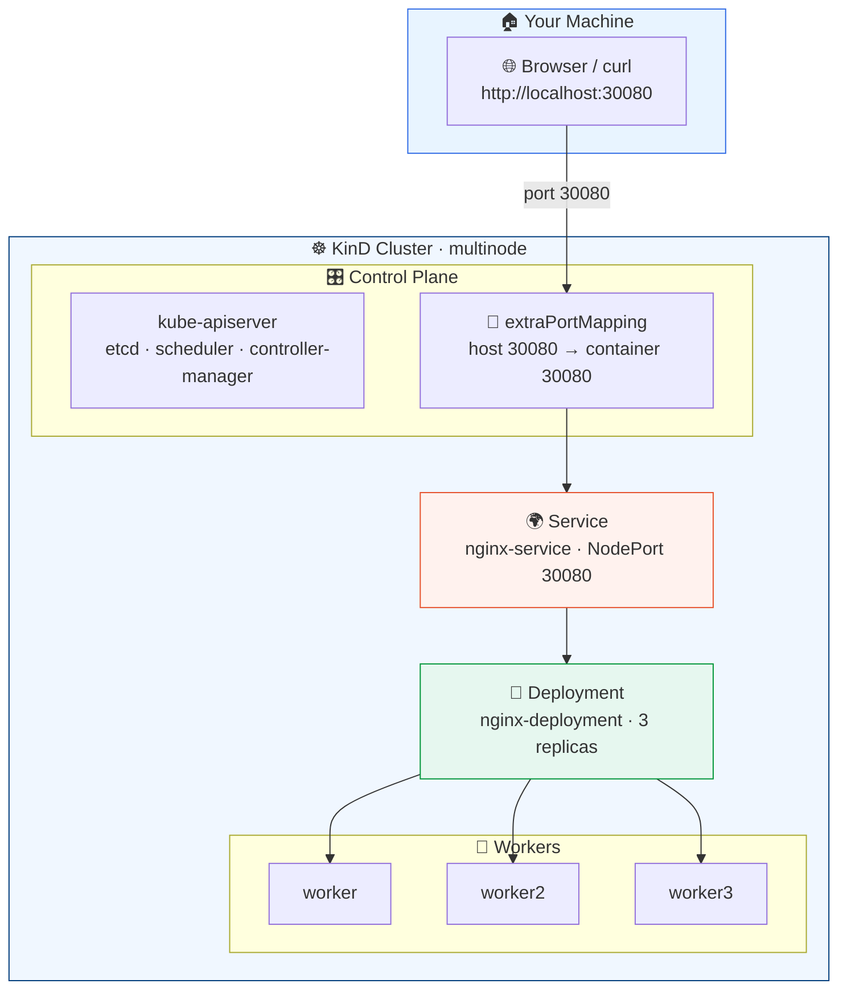

<div align="center">

<a id="top"></a>

# ☸️ KinD Multi-Node Cluster

*A local Kubernetes playground with a demo Nginx service*

[](https://kubernetes.io/)
[](https://kind.sigs.k8s.io/)
[](https://docs.docker.com/get-docker/)
[](LICENSE)

<br>

[](#-quick-start)

</div>

---

<div align="center">

> 🐳 Built with **[KinD](https://kind.sigs.k8s.io/)** (Kubernetes in Docker): a **4-node cluster** (1 control plane + 3 workers) plus a demo **Nginx deployment** and **NodePort service** exposed on your host at port `30080`.

</div>

<div align="center">

> ⚠️ **For local development and testing only** — not for production. ⚠️

</div>

---

## 📑 Table of Contents

- [🏁 Quick Start](#-quick-start)
- [📁 Repository Layout](#-repository-layout)
- [🏗 Architecture](#-architecture)
- [🧠 How It All Fits Together](#-how-it-all-fits-together)
- [✅ Prerequisites](#-prerequisites)
- [🚀 Step 1 — Create the Cluster](#-step-1--create-the-cluster)
- [🔍 Step 2 — Verify the Cluster](#-step-2--verify-the-cluster)
- [🚀 Step 3 — Deploy the Demo App](#-step-3--deploy-the-demo-app)
- [🌐 Step 4 — Access the Service](#-step-4--access-the-service)
- [🧹 Cleanup](#-cleanup)
- [🩺 Troubleshooting](#-troubleshooting)
- [📝 Notes](#-notes)
- [📚 Further Reading](#-further-reading)
- [📜 License](#-license)

---

## 🏁 Quick Start

Just want it running? Copy-paste these three commands:

```bash
# 1️⃣ spin up the 4-node cluster (skipped if it already exists)
kind get clusters | grep -qx multinode || kind create cluster --config config.yaml

# 2️⃣ deploy nginx + NodePort service (safe to re-run)
kubectl apply -f deployment.yaml -f service.yaml

# 3️⃣ enjoy the demo 🎉
curl http://localhost:30080
```

> 💡 …or just open <http://localhost:30080> in your browser.

<details>
<summary>🎬 <b>Prefer <code>make</code>? Same thing in five targets:</b></summary>

<br>

```bash
make install   # 📦 one-time: install kind + kubectl into ~/.local/bin
make up        # 1️⃣ create the cluster (skips if it exists)
make deploy    # 2️⃣ apply deployment.yaml + service.yaml
make test      # 3️⃣ curl http://localhost:30080
make down      # 🗑️ tear the cluster down again
```

</details>

<details>
<summary>⚠️ <b>Got <code>node(s) already exist for a cluster with the name "multinode"</code>?</b></summary>

<br>

That just means the cluster is **already running** — `kind create` refuses to reuse a name. It's safe to continue with step 2, or start fresh:

```bash
kind get clusters                        # list existing clusters
kind delete cluster --name multinode     # …then recreate from scratch
```

The `unchanged` output from `kubectl apply` on a re-run is also normal — the resources already exist.

</details>

---

## 📁 Repository Layout

<table>
<tr><th>📄 File</th><th>📝 Description</th></tr>
<tr>
  <td><code>🧩 config.yaml</code></td>
  <td>Full-featured KinD cluster config — kubeadm patches, eviction thresholds, <code>certSANs</code>, port mapping, <b>digest-pinned node image</b></td>
</tr>
<tr>
  <td><code>⚡ config-test.yaml</code></td>
  <td>Minimal KinD config — the same 4-node topology with zero extra customization</td>
</tr>
<tr>
  <td><code>🚀 deployment.yaml</code></td>
  <td><code>nginx-deployment</code> — 3 replicas of <code>nginx:latest</code> with readiness/liveness probes and CPU/memory requests</td>
</tr>
<tr>
  <td><code>🌐 service.yaml</code></td>
  <td><code>nginx-service</code> — a <code>NodePort</code> service mapping <code>30080 → 80</code></td>
</tr>
<tr>
  <td><code>🎬 Makefile</code></td>
  <td>Convenience targets — <code>install</code>, <code>up</code>, <code>deploy</code>, <code>test</code>, <code>down</code>, <code>lint</code></td>
</tr>
<tr>
  <td><code>🔁 renovate.json</code></td>
  <td>Renovate config — opens a PR when the <code>nginx:latest</code> digest changes (install the Renovate GitHub App to activate)</td>
</tr>
</table>

---

## 🏗 Architecture



---

## 🧠 How It All Fits Together

Four building blocks, each backed by a file in this repo:

| # | 🧱 Layer | 📄 Defined in | 👀 See it with |
| --- | --- | --- | --- |
| 1️⃣ | **☸️ Cluster** — the whole Kubernetes system | `config.yaml` | `kubectl cluster-info` |
| 2️⃣ | **👷 Nodes** — the 4 machines it runs on | `config.yaml` → `nodes:` | `kubectl get nodes` |
| 3️⃣ | **🚀 Deployment** — *what* should run (3 nginx pods) | `deployment.yaml` | `kubectl get deploy` |
| 4️⃣ | **🌍 Service** — *how* to reach it (port 30080) | `service.yaml` | `kubectl get svc` |

### ☸️ The cluster

The **cluster** is the Kubernetes control system itself: API server, etcd, scheduler and controller-manager, plus the worker machines. `kind create cluster --config config.yaml` builds one out of plain containers on your machine, names it `multinode`, and points `kubectl` at the context `kind-multinode`. Everything below lives *inside* this — and `kind delete cluster` takes all of it away in one go.

### 👷 The nodes

**Nodes** are the machines (here: containers) that do the actual work — **1 control-plane + 3 workers**:

- **Control-plane** — runs the brain (`kube-apiserver`, `etcd`, scheduler, controller-manager). In this config it also carries the `extraPortMappings` entry, so it's the door between your `localhost:30080` and the cluster.
- **Workers** — where application pods are scheduled. The scheduler spreads the 3 nginx replicas across them, so if one worker dies only *one* replica is briefly lost — the Deployment replaces it immediately.

All four boot from the same digest-pinned image (`kindest/node:v1.37.0@sha256:…`), so every node is identical and reproducible.

### 🚀 The Deployment — *what* runs

`deployment.yaml` declares a **desired state**: *"there must always be 3 nginx pods"*. The Deployment controller watches reality and fixes the gap:

- **Creates** pods until 3 exist, **replaces** any that crash or get evicted 🔄
- Groups them with the label `app: nginx` — the hook that both the Deployment and the Service use 🏷️
- The **readiness probe** gates what counts as *Ready*: a pod only enters rotation once it really answers HTTP ✅

`kubectl get deploy` showing `3/3` means: desired 3, healthy 3 — not merely "3 containers started".

### 🌍 The Service — *how* you reach it

Pods are **ephemeral** — they get new IPs every time they're replaced, so you can't hard-wire them. A **Service** provides one stable address (`nginx-service`) in front of them:

- **Selector** `app: nginx` → Kubernetes continuously discovers matching pods and maintains an *endpoint list* (`kubectl get endpoints nginx-service`). Dead pods drop out automatically; replacements join.
- **Type `NodePort`** → opens port **30080 on every node** and forwards to the pods, load-balancing across all three.
- `nodePort: 30080` ↔ `targetPort: 80` ↔ `containerPort: 80`: **node → service → container** (must line up with `extraPortMappings` in `config.yaml`).

### 🔗 The full path of a request

```text
curl http://localhost:30080
   │
   1️⃣  your machine → host port 30080
   2️⃣  Docker/Podman port mapping → control-plane node container :30080
   3️⃣  kube-proxy: NodePort 30080 → Service "nginx-service"
   4️⃣  Service selector (app: nginx) → picks ONE of the 3 ready pods
   5️⃣  DNAT → pod IP:80 → nginx answers
   6️⃣  response retraces the path back to your terminal 🎉
```

Break any link and you get a specific symptom — that's what the [🩺 Troubleshooting](#-troubleshooting) table maps out.

---

## ✅ Prerequisites

| 🛠️ Tool | 📦 Install |
| --- | --- |
| 🐧 **Podman** or **Docker** | Debian/Ubuntu: `sudo apt install podman` · macOS: `brew install podman` · or [Docker](https://docs.docker.com/get-docker/) |
| 🧷 **KinD** `v0.33.0` | **`make install`** · `brew install kind` · or [manual download](https://kind.sigs.k8s.io/docs/user/quick-start/#installation) |
| 🔧 **kubectl** `v1.37.x` | **`make install`** · `brew install kubectl` · or [install docs](https://kubernetes.io/docs/tasks/tools/) |

> 📦 **`make install`** downloads pinned, official binaries of both kind and kubectl into `~/.local/bin` (and tells you if that's not on your `PATH` yet).
>
> 🧾 **Verified with:** kind `v0.33.0` · kubectl `v1.37.2` · Podman `6.1.1` · Kubernetes `v1.37.0` · Linux/amd64

---

## 🚀 Step 1 — Create the Cluster

```bash
kind create cluster --config config.yaml
```

> ⚡ Prefer the bare-bones variant? Use `kind create cluster --config config-test.yaml` instead — same 4 nodes, no kubeadm patches or port mapping (so no `localhost:30080`).

<details>
<summary>🖼️ <b>Expected output</b></summary>

```text
enabling experimental podman provider
Creating cluster "multinode" ...
 • Ensuring node image (kindest/node:v1.37.0) 🖼️  ...
 ✓ Ensuring node image (kindest/node:v1.37.0) 🖼️
 • Preparing nodes 📦 📦 📦 📦   ...
 ✓ Preparing nodes 📦 📦 📦 📦
 • Writing configuration 📜  ...
 ✓ Writing configuration 📜
 • Starting control-plane 🕹️  ...
 ✓ Starting control-plane 🕹️
 • Installing CNI 🔌  ...
 ✓ Installing CNI 🔌
 • Installing StorageClass 💾  ...
 ✓ Installing StorageClass 💾
 • Joining worker nodes 🚜  ...
 ✓ Joining worker nodes 🚜
Set kubectl context to "kind-multinode"
You can now use your cluster with:

kubectl cluster-info --context kind-multinode

Thanks for using kind! 😊
```

</details>

> ⚠️ **Re-running this?** If you see `ERROR: failed to create cluster: node(s) already exist for a cluster with the name "multinode"`, the cluster is already up — that's fine, just skip to Step 2. To recreate it from scratch, run `kind delete cluster --name multinode` first.

---

## 🔍 Step 2 — Verify the Cluster

```bash
kubectl cluster-info --context kind-multinode
kubectl get nodes -o wide
kubectl get pods -A
```

<details>
<summary>🖼️ <b>Expected output</b></summary>

```text
Kubernetes control plane is running at https://127.0.0.1:34299
CoreDNS is running at https://127.0.0.1:34299/api/v1/namespaces/kube-system/services/kube-dns:dns/proxy

To further debug and diagnose cluster problems, use 'kubectl cluster-info dump'.

NAME                      STATUS   ROLES           AGE   VERSION   INTERNAL-IP   EXTERNAL-IP   OS-IMAGE                       KERNEL-VERSION               CONTAINER-RUNTIME
multinode-control-plane   Ready    control-plane   26s   v1.37.0   10.89.0.46    <none>        Debian GNU/Linux 13 (trixie)   7.2.11+deb14-amd64 (amd64)   containerd://2.3.4
multinode-worker          Ready    <none>          15s   v1.37.0   10.89.0.43    <none>        Debian GNU/Linux 13 (trixie)   7.2.11+deb14-amd64 (amd64)   containerd://2.3.4
multinode-worker2         Ready    <none>          15s   v1.37.0   10.89.0.44    <none>        Debian GNU/Linux 13 (trixie)   7.2.11+deb14-amd64 (amd64)   containerd://2.3.4
multinode-worker3         Ready    <none>          15s   v1.37.0   10.89.0.45    <none>        Debian GNU/Linux 13 (trixie)   7.2.11+deb14-amd64 (amd64)   containerd://2.3.4

NAMESPACE            NAME                                              READY   STATUS    RESTARTS   AGE
kube-system          coredns-559f6c778d-4fxjt                          1/1     Running   0          16s
kube-system          coredns-559f6c778d-pr42b                          1/1     Running   0          16s
kube-system          etcd-multinode-control-plane                      1/1     Running   0          24s
kube-system          kindnet-bpzlr                                     1/1     Running   0          16s
kube-system          kindnet-h2brt                                     1/1     Running   0          15s
kube-system          kindnet-nzskr                                     1/1     Running   0          15s
kube-system          kindnet-tk22b                                     1/1     Running   0          15s
kube-system          kube-apiserver-multinode-control-plane            1/1     Running   0          25s
kube-system          kube-controller-manager-multinode-control-plane   1/1     Running   0          24s
kube-system          kube-proxy-548p8                                  1/1     Running   0          15s
kube-system          kube-proxy-97q4b                                  1/1     Running   0          15s
kube-system          kube-proxy-ll88z                                  1/1     Running   0          15s
kube-system          kube-proxy-zmplm                                  1/1     Running   0          16s
kube-system          kube-scheduler-multinode-control-plane            1/1     Running   0          24s
local-path-storage   local-path-provisioner-75f7fc7dc5-b5hgg           1/1     Running   0          16s
```

</details>

> 🕐 Captured fresh from a real run — exact **IPs, ages, ports and pod names will differ** on your machine.

---

## 🚀 Step 3 — Deploy the Demo App

```bash
kubectl apply -f deployment.yaml
kubectl apply -f service.yaml
```

Then check that everything is up:

```bash
kubectl get deploy
kubectl get svc
kubectl get pods -l app=nginx -o wide
```

<div align="center">

✅ 🎉 &nbsp;`nginx-deployment` reports **`3/3`** ready replicas &nbsp;·&nbsp; 🌐 &nbsp;`nginx-service` is **`NodePort`** on port **`30080`**

</div>

<details>
<summary>🖼️ <b>Expected output</b></summary>

```text
NAME               READY   UP-TO-DATE   AVAILABLE   AGE
nginx-deployment   3/3     3            3           59s

NAME            TYPE        CLUSTER-IP     EXTERNAL-IP   PORT(S)        AGE
kubernetes      ClusterIP   10.96.0.1      <none>        443/TCP        98s
nginx-service   NodePort    10.96.114.81   <none>        80:30080/TCP   59s

NAME                                READY   STATUS    RESTARTS   AGE   IP           NODE                NOMINATED NODE   READINESS GATES
nginx-deployment-5fcfb85445-b85pq   1/1     Running   0          59s   10.244.3.2   multinode-worker3   <none>           <none>
nginx-deployment-5fcfb85445-dzntd   1/1     Running   0          59s   10.244.2.2   multinode-worker2   <none>           <none>
nginx-deployment-5fcfb85445-k5sz6   1/1     Running   0          59s   10.244.1.2   multinode-worker    <none>           <none>
```

</details>

> 🕐 Note how the three pods land on three **different workers** — that's the scheduler spreading the replicas for you.

---

## 🌐 Step 4 — Access the Service

The service is reachable on your machine at **<http://localhost:30080>** — the control-plane node maps host port `30080` to container port `30080` (see `extraPortMappings` in `config.yaml`).

```bash
curl http://localhost:30080
```

<details>
<summary>🖼️ <b>Expected response</b></summary>

```html
<!DOCTYPE html>
<html>
<head>
<title>Welcome to nginx!</title>
...
</html>
```

</details>

---

## 🧹 Cleanup

**1️⃣ Remove the demo app** (optional — the cluster keeps running):

```bash
kubectl delete -f deployment.yaml -f service.yaml
```

**2️⃣ Delete the cluster:**

```bash
# 🗑️ delete a single cluster (uses current context)
kind delete cluster

# 🗑️💥 delete every KinD cluster
kind delete clusters --all
```

---

## 🩺 Troubleshooting

| 😵 Symptom | 🔍 Likely cause | 🛠️ Fix |
| --- | --- | --- |
| `node(s) already exist for a cluster with the name "multinode"` | The cluster is already running — `kind create` won't reuse a name | Skip creation, or `kind delete cluster --name multinode` first |
| `curl: (7) Failed to connect … port 30080` | Cluster was made with `config-test.yaml` (no `extraPortMappings`), or the control plane isn't ready | Use `config.yaml`, then `kubectl get nodes` until all are `Ready` |
| `kubectl` errors like `connection refused` / wrong cluster | Your context points elsewhere | `kubectl config use-context kind-multinode` |
| Pods stuck `Pending` | Nodes out of CPU/memory (4 nodes × small machine) | `kubectl describe pod <name>` — check the `Events` section |
| `502`/`504` from the service, or `curl` returns nothing | Service selector doesn't match any pod | `kubectl get endpoints nginx-service` must list pod IPs |
| `bind: address already in use` on cluster create | Host port `30080` is taken by another process | Stop it, or change **both** `hostPort` (`config.yaml`) and `nodePort` (`service.yaml`) |

> 🐛 Still stuck? `kubectl get pods -A` + `kubectl get events --sort-by=.lastTimestamp` usually names the real problem.

---

## 📝 Notes

| | 💡 Tip |
| --- | --- |
| 🧩 | `config.yaml` demonstrates a wide range of KinD/kubeadm options — it is intentionally a **"kitchen sink"** example. Trim it to what you need. |
| ⚡ | `config-test.yaml` is the stripped-down equivalent if you just want the same 4-node topology. ⚠️ It has **no `extraPortMappings`**, so NodePort `30080` is not reachable from your host. |
| ✏️ | Feel free to adapt `deployment.yaml` and `service.yaml` to your own application. |
| 📌 | The node image is pinned as `kindest/node:v1.37.0@sha256:…` — kind's release notes require the digest for a reproducible cluster. Re-pin it when upgrading Kubernetes. |
| 🔁 | `renovate.json` makes Renovate open a PR whenever the `nginx:latest` digest moves. ⚠️ Requires the [Renovate GitHub App](https://github.com/apps/renovate) — Dependabot can't read Kubernetes manifests. |
| 🐛 | Something not working? Check `kubectl get nodes` and `kubectl get pods -A` first — the control plane may still be starting. |

---

## 📚 Further Reading

| 📖 Topic | 🔗 Link |
| --- | --- |
| 🧷 Getting started with KinD | <https://kind.sigs.k8s.io/docs/user/quick-start/> |
| ☸️ Kubernetes documentation | <https://kubernetes.io/docs/home/> |
| 🔧 `kubectl` cheat sheet | <https://kubernetes.io/docs/reference/kubectl/cheatsheet/> |
| 🚀 Deployments — the *what* of this demo | <https://kubernetes.io/docs/concepts/workloads/controllers/deployment/> |
| 🌐 Services — the *how* of this demo | <https://kubernetes.io/docs/concepts/services-networking/service/> |
| 🏷️ Labels & selectors — what glues them together | <https://kubernetes.io/docs/concepts/overview/working-with-objects/labels/> |

---

## 📜 License

Licensed under the **GPL-3.0 License** — see the [`LICENSE`](LICENSE) file for the full text.

<br>

<div align="center">

⬆️ Found this helpful? Give the repo a ⭐ on GitHub! ⬆️

<sub>Made with ❤️ and ☸️ &nbsp;·&nbsp; [🔝 Back to top](#top)</sub>

</div>
