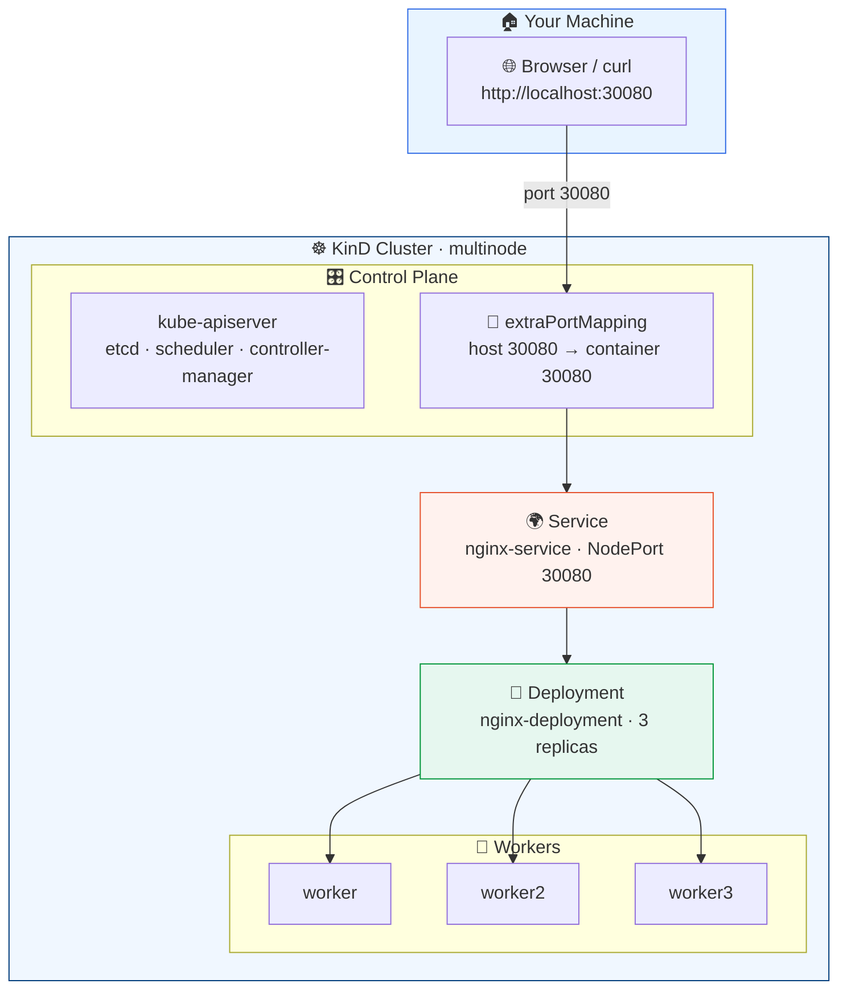

<div align="center">

<a id="top"></a>

# ☸️ KinD Multi-Node Cluster

*A local Kubernetes playground with a demo Nginx service*

[](https://kubernetes.io/)
[](https://kind.sigs.k8s.io/)
[](https://www.nginx.com/)
[](https://kubernetes.io/docs/tasks/tools/)
[](LICENSE)

<br>


</div>

---

> 🐳 Built with **[KinD](https://kind.sigs.k8s.io/)** (Kubernetes in Docker): a **4-node cluster** (1 control plane + 3 workers) plus a demo **Nginx deployment** and **NodePort service** exposed on your host at port `30080`.

<div align="center">

> ⚠️ **For local development and testing only** — not for production. ⚠️

</div>

---

## 📑 Table of Contents

- [🏁 Quick Start](#-quick-start)
- [📁 Repository Layout](#-repository-layout)
- [🏗️ Architecture](#-architecture)
- [✅ Prerequisites](#-prerequisites)
- [🚀 Step 1 — Create the Cluster](#-step-1--create-the-cluster)
- [🔍 Step 2 — Verify the Cluster](#-step-2--verify-the-cluster)
- [🚀 Step 3 — Deploy the Demo App](#-step-3--deploy-the-demo-app)
- [🌐 Step 4 — Access the Service](#-step-4--access-the-service)
- [🧹 Cleanup](#-cleanup)
- [📝 Notes](#-notes)
- [📜 License](#-license)

---

## 🏁 Quick Start

Just want it running? Copy-paste these three commands:

```bash
# 1️⃣ spin up the 4-node cluster (skipped if it already exists)
kind get clusters | grep -qx multinode || kind create cluster --config config.yaml

# 2️⃣ deploy nginx + NodePort service (safe to re-run)
kubectl apply -f deployment.yaml -f service.yaml

# 3️⃣ enjoy the demo 🎉
curl http://localhost:30080
```

> 💡 …or just open <http://localhost:30080> in your browser.

<details>
<summary>⚠️ <b>Got <code>node(s) already exist for a cluster with the name "multinode"</code>?</b></summary>

<br>

That just means the cluster is **already running** — `kind create` refuses to reuse a name. It's safe to continue with step 2, or start fresh:

```bash
kind get clusters                        # list existing clusters
kind delete cluster --name multinode     # …then recreate from scratch
```

The `unchanged` output from `kubectl apply` on a re-run is also normal — the resources already exist.

</details>

---

## 📁 Repository Layout

<table>
<tr><th>📄 File</th><th>📝 Description</th></tr>
<tr>
  <td><code>🧩 config.yaml</code></td>
  <td>Full-featured KinD cluster config — kubeadm patches, eviction thresholds, <code>certSANs</code>, port mapping</td>
</tr>
<tr>
  <td><code>⚡ config-test.yaml</code></td>
  <td>Minimal KinD config — the same 4-node topology with zero extra customization</td>
</tr>
<tr>
  <td><code>🚀 deployment.yaml</code></td>
  <td><code>nginx-deployment</code> — 3 replicas of <code>nginx:latest</code> listening on port 80</td>
</tr>
<tr>
  <td><code>🌐 service.yaml</code></td>
  <td><code>nginx-service</code> — a <code>NodePort</code> service mapping <code>30080 → 80</code></td>
</tr>
</table>

---

## 🏗 Architecture



---

## ✅ Prerequisites

| 🛠️ Tool | 📥 Install |
| --- | --- |
| 🐧 **Podman** or **Docker** | Must be installed and running |
| 🧷 **KinD** | <https://kind.sigs.k8s.io/docs/user/quick-start/> |
| 🔧 **kubectl** | <https://kubernetes.io/docs/tasks/tools/> |

---

## 🚀 Step 1 — Create the Cluster

```bash
kind create cluster --config config.yaml
```

<details>
<summary>🖼️ <b>Expected output</b></summary>

```text
enabling experimental podman provider
Creating cluster "multinode" ...
✓ Ensuring node image (kindest/node:v1.37.0) 🖼️
✓ Preparing nodes 📦 📦 📦 📦
✓ Writing configuration 📜
✓ Starting control-plane 🕹️
✓ Installing CNI 🔌
✓ Installing StorageClass 💡
✓ Joining worker nodes 🚜
Set kubectl context to "kind-multinode"
You can now use your cluster with:

kubectl cluster-info --context kind-multinode

Thanks for using kind! 😊
```

</details>

> ⚠️ **Re-running this?** If you see `ERROR: failed to create cluster: node(s) already exist for a cluster with the name "multinode"`, the cluster is already up — that's fine, just skip to Step 2. To recreate it from scratch, run `kind delete cluster --name multinode` first.

---

## 🔍 Step 2 — Verify the Cluster

```bash
kubectl cluster-info --context kind-multinode
kubectl get nodes -o wide
kubectl get pods -A
```

<details>
<summary>🖼️ <b>Expected output</b></summary>

```text
Kubernetes control plane is running at https://127.0.0.1:36397
CoreDNS is running at https://127.0.0.1:36397/api/v1/namespaces/kube-system/services/kube-dns:dns/proxy

To further debug and diagnose cluster problems, use 'kubectl cluster-info dump'.

NAME                      STATUS   ROLES           AGE   VERSION   INTERNAL-IP   EXTERNAL-IP   OS-IMAGE                       KERNEL-VERSION               CONTAINER-RUNTIME
multinode-control-plane   Ready    control-plane   57s   v1.37.0   10.89.0.32    <none>        Debian GNU/Linux 13 (trixie)   7.2.11+deb14-amd64 (amd64)   containerd://2.3.4
multinode-worker          Ready    <none>          47s   v1.37.0   10.89.0.33    <none>        Debian GNU/Linux 13 (trixie)   7.2.11+deb14-amd64 (amd64)   containerd://2.3.4
multinode-worker2         Ready    <none>          47s   v1.37.0   10.89.0.31    <none>        Debian GNU/Linux 13 (trixie)   7.2.11+deb14-amd64 (amd64)   containerd://2.3.4
multinode-worker3         Ready    <none>          47s   v1.37.0   10.89.0.34    <none>        Debian GNU/Linux 13 (trixie)   7.2.11+deb14-amd64 (amd64)   containerd://2.3.4

NAMESPACE            NAME                                              READY   STATUS    RESTARTS   AGE
kube-system          coredns-559f6c778d-2s7rw                          1/1     Running   0          49s
kube-system          coredns-559f6c778d-l8lhj                          1/1     Running   0          49s
kube-system          etcd-multinode-control-plane                      1/1     Running   0          56s
kube-system          kindnet-bglvv                                     1/1     Running   0          47s
kube-system          kindnet-cbtzg                                     1/1     Running   0          47s
kube-system          kindnet-qhwfm                                     1/1     Running   0          47s
kube-system          kindnet-rdg7g                                     1/1     Running   0          49s
kube-system          kube-apiserver-multinode-control-plane            1/1     Running   0          57s
kube-system          kube-controller-manager-multinode-control-plane   1/1     Running   0          57s
kube-system          kube-proxy-2c8zv                                  1/1     Running   0          47s
kube-system          kube-proxy-n29b7                                  1/1     Running   0          49s
kube-system          kube-proxy-qck8s                                  1/1     Running   0          47s
kube-system          kube-proxy-sl5tf                                  1/1     Running   0          47s
kube-system          kube-scheduler-multinode-control-plane            1/1     Running   0          56s
local-path-storage   local-path-provisioner-75f7fc7dc5-fbzsk           1/1     Running   0          49s
```

</details>

---

## 🚀 Step 3 — Deploy the Demo App

```bash
kubectl apply -f deployment.yaml
kubectl apply -f service.yaml
```

Then check that everything is up:

```bash
kubectl get deployments
kubectl get services
kubectl get pods -l app=nginx -o wide
```

<div align="center">

✅ &nbsp;`nginx-deployment` reports **`3/3`** ready replicas &nbsp;·&nbsp; 🌐 &nbsp;`nginx-service` is **`NodePort`** on port **`30080`**

</div>

---

## 🌐 Step 4 — Access the Service

The service is reachable on your machine at **<http://localhost:30080>** — the control-plane node maps host port `30080` to container port `30080` (see `extraPortMappings` in `config.yaml`).

```bash
curl http://localhost:30080
```

<details>
<summary>🖼️ <b>Expected response</b></summary>

```html
<!DOCTYPE html>
<html>
<head>
<title>Welcome to nginx!</title>
...
</html>
```

</details>

---

## 🧹 Cleanup

**1️⃣ Remove the demo app** (optional — the cluster keeps running):

```bash
kubectl delete -f deployment.yaml -f service.yaml
```

**2️⃣ Delete the cluster:**

```bash
# 🗑️ delete a single cluster (uses current context)
kind delete cluster

# 🗑️💥 delete every KinD cluster
kind delete clusters --all
```

---

## 📝 Notes

| | 💡 Tip |
| --- | --- |
| 🧩 | `config.yaml` demonstrates a wide range of KinD/kubeadm options — it is intentionally a **"kitchen sink"** example. Trim it to what you need. |
| ⚡ | `config-test.yaml` is the stripped-down equivalent if you just want the same 4-node topology. ⚠️ It has **no `extraPortMappings`**, so NodePort `30080` is not reachable from your host. |
| ✏️ | Feel free to adapt `deployment.yaml` and `service.yaml` to your own application. |
| 🐛 | Something not working? Check `kubectl get nodes` and `kubectl get pods -A` first — the control plane may still be starting. |

---

## 📜 License

Licensed under the **GPL-3.0 License** — see the [`LICENSE`](LICENSE) file for the full text.

<br>

<div align="center">

⬆️ Found this helpful? Give the repo a ⭐ on GitHub! ⬆️

<sub>Made with ❤️ and ☸️ &nbsp;·&nbsp; [🔝 Back to top](#top)</sub>

</div>
